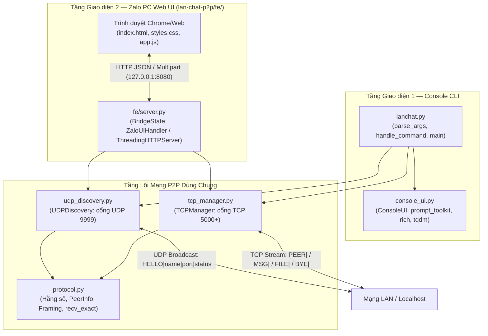
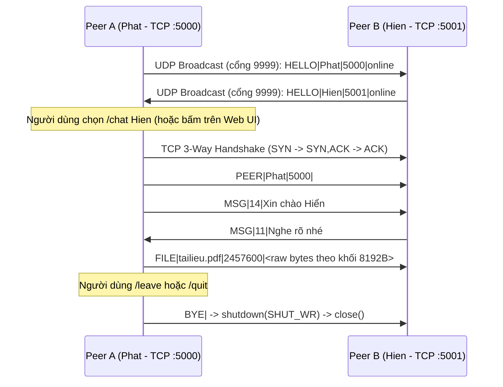

# BÁO CÁO KỸ THUẬT ĐỒ ÁN

## LAN Chat & File Sharing (P2P) — Using TCP and UDP Sockets

**Môn học:** Lập trình Mạng (Socket Programming)  
**Repository:** `Socket_PQH` (`lan-chat-p2p/`)  
**Ngôn ngữ & Công nghệ:** Python 3 (`socket`, `threading`, `http.server`), `prompt_toolkit`, `rich`, `tqdm`, HTML/CSS/JavaScript thuần

| STT | Họ và tên | MSSV |
| :-: | :--- | :---: |
| 1 | Châu Hòa Phát | `25127224` |
| 2 | Huỳnh Nguyễn Thế Hiển | `25127327` |
| 3 | Đỗ Nguyễn Nhật Quang | `25127478` |

> **Ghi chú về tính xác thực:** Mọi tên lớp, hàm, hằng số, luồng, endpoint HTTP, đường dẫn tệp và hành vi kỹ thuật được trình bày trong báo cáo này đều trích trực tiếp từ mã nguồn thực tế trong repository (`README.md`, `AGENTS.md`, `GUIDE.md`, `lan-chat-p2p/CONTRACTS.md`, `lan-chat-p2p/*.py` và `lan-chat-p2p/fe/*`). Những phần cần ảnh chụp thực tế khi nộp bài (ảnh Wireshark) hoặc phần phân công chưa ghi trong `GUIDE.md` được đánh dấu rõ là **[Nhóm bổ sung]**.

---

## Mục lục

1. [Chương 1. Tổng quan Đồ án & Phân công Nhóm](#chương-1-tổng-quan-đồ-án--phân-công-nhóm)
2. [Chương 2. Kiến trúc Hệ thống (System Architecture)](#chương-2-kiến-trúc-hệ-thống-system-architecture)
3. [Chương 3. Mô hình Đa luồng (Thread Model) & Đồng bộ hóa (Thread Safety)](#chương-3-mô-hình-đa-luồng-thread-model--đồng-bộ-hóa-thread-safety)
4. [Chương 4. Thiết kế Giao thức Tầng Ứng dụng & Đóng khung Bản tin (Protocol Format & TCP Framing)](#chương-4-thiết-kế-giao-thức-tầng-ứng-dụng--đóng-khung-bản-tin-protocol-format--tcp-framing)
5. [Chương 5. Thiết kế Giao diện Người dùng: Console CLI & Giao diện Zalo Web UI](#chương-5-thiết-kế-giao-diện-người-dùng-console-cli--giao-diện-zalo-web-ui)
6. [Chương 6. Các Vấn đề Gặp phải & Giải pháp Kỹ thuật (Problems Faced & Solutions)](#chương-6-các-vấn-đề-gặp-phải--giải-pháp-kỹ-thuật-problems-faced--solutions)
7. [Chương 7. Kết quả Kiểm thử & Hướng dẫn Phân tích Gói tin Wireshark](#chương-7-kết-quả-kiểm-thử--hướng-dẫn-phân-tích-gói-tin-wireshark)
8. [Chương 8. Hạn chế Đã biết & Kết luận](#chương-8-hạn-chế-đã-biết--kết-luận)

---

## Chương 1. Tổng quan Đồ án & Phân công Nhóm

### 1.1. Đặt vấn đề & Mục tiêu đồ án

Ứng dụng nhắn tin và chia sẻ tệp tin trong mạng cục bộ (LAN/Wi-Fi) là bài toán thực tiễn giúp hiểu rõ bản chất lập trình Socket ở tầng giao vận mà không phụ thuộc vào máy chủ trung tâm. Trong mô hình **ngang hàng (Peer-to-Peer — P2P)** của đồ án **LAN Chat & File Sharing (P2P)**:

- Mọi người dùng chạy cùng một chương trình nguồn; không có server điều phối trung tâm.
- Mỗi node vừa đóng vai trò **Server** (lắng nghe gói tin khám phá UDP và chấp nhận kết nối TCP đến) vừa đóng vai trò **Client** (phát gói quảng bá sự hiện diện và chủ động mở kết nối TCP tới peer khác).
- Hệ thống cho phép tự động tìm kiếm người dùng trong mạng LAN, theo dõi trạng thái trực tuyến (`online` / `away`), trò chuyện đồng thời với nhiều peer (kèm hàng đợi tin nhắn chưa đọc `unread`), và gửi/nhận tệp tin theo luồng riêng mà không chặn thao tác chat.
- Ngoài giao diện dòng lệnh chuẩn (`lanchat.py` + `console_ui.py`), dự án mở rộng thêm giao diện **Zalo PC Web UI** (`lan-chat-p2p/fe/`) chạy trên trình duyệt web thông qua cầu nối HTTP cục bộ sử dụng thư viện chuẩn `http.server`, kết nối trực tiếp vào cùng lõi UDP/TCP.

### 1.2. Thông tin thành viên & Phân công công việc

Theo thông tin thành viên (`README.md`, `lan-chat-p2p/README.md`) và bảng phân công kỹ thuật trong `GUIDE.md`:

| STT | Họ và tên | MSSV | File phụ trách (theo `GUIDE.md`) | Nhiệm vụ chính (theo `GUIDE.md`) |
| :-: | :--- | :---: | :--- | :--- |
| 1 | Châu Hòa Phát | `25127224` | `lan-chat-p2p/protocol.py`<br>`lan-chat-p2p/udp_discovery.py`<br>`lan-chat-p2p/lanchat.py` | - Hiện thực `PeerInfo`, encode/decode UDP `HELLO\|`, TCP framing (`PEER\|`, `MSG\|`, `FILE\|`, `BYE\|`), `recv_exact`, `read_frame_header`.<br>- Hiện thực UDP discovery (`9999`), broadcast `3s`, listener, bảng peer online (`Lock`), timeout `10s`, `/status`.<br>- Hiện thực CLI `argparse` (`--name`, `--port`, `--bcast`, `--udp-port`), điều phối 8 lệnh và ghép nối các module. |
| 2 | Huỳnh Nguyễn Thế Hiển | `25127327` | `lan-chat-p2p/console_ui.py`<br>`lan-chat-p2p/tcp_manager.py` | - Hiện thực giao diện console không vỡ dòng đang gõ (`prompt_toolkit` + `patch_stdout`), bảng `/list` (`rich`), progress bar (`tqdm`).<br>- Hiện thực TCP acceptor & kết nối tới peer, 1 receiver thread/peer, lịch sử chat & `unread` counter (`Lock`).<br>- Hiện thực truyền/nhận file theo chunk chạy thread riêng, lưu vào `downloads/`, xóa partial file khi lỗi. |
| 3 | Đỗ Nguyễn Nhật Quang | `25127478` | **[Nhóm bổ sung]** | **[Nhóm bổ sung — chưa ghi phân công cụ thể trong `GUIDE.md`, bao gồm phần giao diện `lan-chat-p2p/fe/` hoặc báo cáo/kiểm thử]** |

Lộ trình triển khai trong `GUIDE.md` được chia thành 3 chặng:
- **Chặng 1 (Nền tảng độc lập):** Xây dựng `protocol.py` (giao thức & framing) và `console_ui.py` (UI terminal độc lập).
- **Chặng 2 (Tầng mạng):** Xây dựng `udp_discovery.py` (tầng UDP) và `tcp_manager.py` (tầng TCP) bám sát giao diện hợp đồng trong `lan-chat-p2p/CONTRACTS.md`.
- **Chặng 3 (Ghép nối & Kiểm thử):** Tích hợp vào `lanchat.py`, kiểm thử đa peer, truyền file đồng thời, xử lý lỗi và phân tích gói tin Wireshark.

### 1.3. Lý do kết hợp cả hai giao thức UDP và TCP

Đồ án cố ý khai thác song song cả hai giao thức tầng giao vận để mỗi giao thức đảm nhiệm đúng bài toán phù hợp với đặc tính của nó:

| Tiêu chí so sánh | UDP (`UDP_PORT = 9999`) | TCP (`DEFAULT_TCP_PORT = 5000`) |
| :--- | :--- | :--- |
| **Vai trò trong đồ án** | Peer Discovery & cập nhật trạng thái (`online`, `away`) | Chat văn bản đa phiên & truyền tệp tin nhị phân |
| **Bản chất giao thức** | Connectionless (không thiết lập kết nối), gửi datagram nhanh, hỗ trợ Broadcast (`DEFAULT_BCAST = "255.255.255.255"`) | Connection-oriented (bắt tay 3 bước), luồng byte tin cậy, bảo toàn thứ tự, kiểm soát lỗi & luồng |
| **Mất gói tin** | Có thể chấp nhận mất gói đơn lẻ vì chu kỳ phát lại là `BROADCAST_INTERVAL = 3.0s`, ngưỡng xóa peer là `PEER_TIMEOUT = 10.0s` | Tuyệt đối không được mất, trùng lặp hay sai lệch thứ tự byte (đặc biệt với tệp tin và tin nhắn) |
| **Cách sử dụng trong code** | Một socket `SOCK_DGRAM` duy nhất gắn cổng `9999` dùng cho cả phát và nghe (`UDPDiscovery`) | Một socket `SOCK_STREAM` lắng nghe ở `--port` và một socket riêng cho mỗi kết nối peer (`TCPManager`) |

---

## Chương 2. Kiến trúc Hệ thống (System Architecture)

### 2.1. Sơ đồ kiến trúc tổng thể

Hệ thống áp dụng nguyên tắc **tách biệt trách nhiệm (Separation of Concerns)** theo quy định trong `AGENTS.md`: tầng giao thức thuần túy nằm ở `protocol.py`, tầng khám phá UDP nằm ở `udp_discovery.py`, tầng truyền tin TCP nằm ở `tcp_manager.py`, và hai giao diện người dùng (Console CLI và Zalo Web UI) cùng gắn vào lõi mạng thông qua cơ chế callback.



Nhờ dùng chung hoàn toàn tầng lõi mạng và định dạng bản tin, một node chạy bằng giao diện Console CLI (`lanchat.py`) và một node khác chạy bằng giao diện Zalo Web UI (`fe/server.py`) vẫn phát hiện nhau qua UDP, trò chuyện hai chiều và truyền tệp tin qua TCP bình thường.

### 2.2. Ràng buộc công nghệ & Cấu trúc thư mục

Theo `AGENTS.md` và `lan-chat-p2p/requirements.txt`:
- **Thư viện chuẩn Python:** `socket`, `threading`, `argparse`, `os`, `time`, `dataclasses`, `contextlib`, `sys`, `http.server`, `json`, `mimetypes`, `subprocess`, `urllib.parse`, `webbrowser`. Tuyệt đối không dùng `asyncio` hay các framework mạng/web cấp cao (`aiohttp`, `twisted`, `websockets`, Flask/FastAPI).
- **Thư viện bên thứ ba (`requirements.txt`):** chỉ gồm `prompt_toolkit>=3.0.43`, `rich>=13.7.0`, `tqdm>=4.66.0` phục vụ giao diện Console CLI.
- **Thư mục `lan-chat-p2p/downloads/`:** chứa các tệp tin nhận (và bản sao gửi từ Web UI), được giữ cấu trúc trong Git nhờ `downloads/.gitkeep` và loại trừ tệp người dùng trong `.gitignore` (`downloads/*`, `!downloads/.gitkeep`).

### 2.3. Chi tiết các module và thành phần trong `lan-chat-p2p/`

| Tệp tin | Lớp / Hàm chính | Ranh giới & Trách nhiệm thực tế (theo `CONTRACTS.md` & mã nguồn) |
| :--- | :--- | :--- |
| `protocol.py` | `PeerInfo`, `encode_hello`, `decode_hello`, `encode_peer`, `encode_msg`, `encode_file_header`, `encode_bye`, `recv_exact`, `_read_field`, `read_frame_header` | Định nghĩa hằng số toàn cục, dataclass `PeerInfo`, đóng gói/giải mã gói tin UDP và khung TCP. Không tạo socket server/thread, không giữ trạng thái peer và không gọi `print()`. |
| `udp_discovery.py` | `UDPDiscovery` (`_make_socket`, `start`, `stop`, `set_status`, `get_peers`, `resolve_peer`, `_send_presence_once`, `_broadcast_loop`, `_listen_loop`, `_handle_datagram`, `_reap_expired_peers`) | Quản lý socket UDP cổng `9999`, phát `HELLO` định kỳ `3.0s`, lắng nghe gói đến, duy trì bảng peer `self._peers` bảo vệ bởi `Lock`, và xóa peer quá `10.0s`. Không mở kết nối TCP. |
| `tcp_manager.py` | `TCPManager` (`start`, `stop`, `get_current_partner`, `connect_peer`, `switch_chat`, `leave_chat`, `send_chat`, `send_file_async`, `_send_file_worker`, `_accept_loop`, `_receiver_loop`, `_handle_incoming_message`, `_receive_file`, `_cleanup_connection`), `_format_size` | Quản lý TCP server acceptor, kết nối ra ngoài, 1 luồng nhận cho mỗi peer, lịch sử chat `_chat_histories`, hàng đợi `_unread_messages`, gửi/nhận tệp tin theo khối `CHUNK_SIZE = 8192` vào `downloads/`. Mọi thông báo đi qua 5 callback (`on_chat`, `on_unread`, `on_system`, `on_error`, `on_progress`). |
| `console_ui.py` | `ConsoleUI` (`__init__`, `close`, `_print_with_bars_paused`, `read_line`, `print_system`, `print_chat`, `print_error`, `show_peers`, `show_help`, `update_progress`) | Giao diện console an toàn đa luồng sử dụng `prompt_toolkit` (`PromptSession` + `patch_stdout`), bảng `rich.table.Table`, thanh tiến độ `tqdm`. Không chứa logic `socket`. |
| `lanchat.py` | `parse_args`, `handle_command`, `main` | Phân tích tham số CLI (`--name`, `--port`, `--bcast`, `--udp-port`), khởi tạo và nối `ConsoleUI` ↔ `TCPManager` ↔ `UDPDiscovery`, chạy vòng lặp nhận lệnh và giải phóng tài nguyên khi thoát. |
| `fe/server.py` | `open_in_chrome_or_default`, `BridgeState`, `make_handler` → `ZaloUIHandler`, `main` | Máy chủ HTTP đa luồng cục bộ (`ThreadingHTTPServer`) phục vụ giao diện web tĩnh trong `fe/`, phục vụ tệp tải về trong `downloads/`, và cung cấp REST API JSON nối trực tiếp vào `UDPDiscovery` và `TCPManager`. |
| `fe/index.html`, `fe/styles.css`, `fe/app.js` | Bố cục 4 cột Zalo PC; `pollBackendState`, `renderConversationList`, `renderActiveChat`, `selectPeer`, `openFileImmediately`, `revealFileInDownloads` | Giao diện người dùng đồ họa chạy trên trình duyệt Chrome: tự động đồng bộ peer LAN, chat, gửi/mở file ngay, kéo/đóng thanh `Thông tin [LAN]`, thả Like khi rê chuột. |

---

## Chương 3. Mô hình Đa luồng (Thread Model) & Đồng bộ hóa (Thread Safety)

### 3.1. Các luồng thực thi song song

Chương trình sử dụng hoàn toàn mô hình đa luồng chuẩn `threading.Thread` (các luồng nền đều đặt `daemon=True` để không kẹt tiến trình khi thoát bất thường) kết hợp `threading.Event` (`_stop_event`) để điều phối dừng sạch sẽ:

| STT | Tên luồng (trong code) | Hàm mục tiêu | Điều kiện chờ (Waits for) | Trách nhiệm cụ thể |
| :-: | :--- | :--- | :--- | :--- |
| 1 | `Main` | `lanchat.py:main()` hoặc `fe/server.py:main()` | Bàn phím (`ui.read_line()`) hoặc yêu cầu HTTP (`server.serve_forever()`) | Ở chế độ CLI: đọc input, phân tách 8 lệnh `/...`, gửi tin nhắn. Ở chế độ Web UI: điều phối `ThreadingHTTPServer`. |
| 2 | `udp-broadcaster` | `UDPDiscovery._broadcast_loop` | `self._stop_event.wait(BROADCAST_INTERVAL)` (`3.0s`) | Gọi `_send_presence_once()` phát gói `HELLO|<name>|<tcp_port>|<status>` định kỳ mỗi 3 giây. |
| 3 | `udp-listener` | `UDPDiscovery._listen_loop` | `sock.recvfrom(1024)` (với `settimeout(1.0)`) | Nhận gói UDP `HELLO`, cập nhật bảng `self._peers`, và gọi `_reap_expired_peers()` sau mỗi lần nhận hoặc hết timeout 1 giây để xóa peer quá `10.0s`. |
| 4 | `tcp-acceptor` | `TCPManager._accept_loop` | `server.accept()` (với `settimeout(1.0)`) | Lắng nghe tối đa hàng đợi `listen(16)`; khi có kết nối mới, khởi tạo ngay một luồng `tcp-recv-<ip>:<port>`. |
| 5 | `tcp-recv-<peer>` / `tcp-recv-<ip>:<port>` | `TCPManager._receiver_loop` *(1 luồng / peer)* | `read_frame_header(sock)` | Đọc tuần tự các khung `PEER\|`, `MSG\|`, `FILE\|`, `BYE\|` trên kết nối của peer đó; phân loại tin hiện hành hay `unread`; ghi file nhận xuống `downloads/`. |
| 6 | `file-send-<partner>` | `TCPManager._send_file_worker` *(1 luồng / phiên gửi)* | Đọc file đĩa & `sock.sendall()` | Mở tệp ở chế độ `"rb"`, đọc từng khối `CHUNK_SIZE = 8192` byte, gửi qua TCP kèm cập nhật `on_progress` mà không chặn thao tác gõ/nhận tin ở các luồng khác. |
| 7 | HTTP worker threads *(chỉ Web UI)* | `ThreadingHTTPServer` → `ZaloUIHandler` | Request HTTP từ trình duyệt | Phục vụ `/api/state`, `/downloads/*` và các lệnh `POST` đồng thời cho trình duyệt. |
| 8 | Timer thread *(chỉ Web UI)* | `threading.Timer(0.4, open_in_chrome_or_default)` | Hết `0.4s` sau khi `server` mở | Tự động mở trình duyệt Google Chrome (hoặc trình duyệt mặc định) một lần duy nhất nếu không truyền cờ `--no-browser`. |

**Cơ chế dừng luồng sạch (`stop()`):** Cả `UDPDiscovery._listen_loop` và `TCPManager._accept_loop` đều đặt `settimeout(1.0)` lên socket lắng nghe để vòng lặp không bị treo vô hạn trong `recvfrom()`/`accept()` khi `self._stop_event.set()` được kích hoạt; đồng thời `stop()` đóng socket lắng nghe và gọi `.join(timeout=1.5)` trên các luồng nền.

### 3.2. Phân tích đồng bộ hóa bằng `threading.Lock`

Toàn bộ dữ liệu chia sẻ giữa các luồng đều được bảo vệ bởi các khóa độc lập:

1. **`UDPDiscovery._lock`:** Bảo vệ từ điển `self._peers: dict[str, PeerInfo]` và trạng thái bản thân `self._status`. Phương thức `get_peers()` tạo bản sao nông gồm các đối tượng `PeerInfo` mới trước khi trả về, nên bên gọi có thể duyệt danh sách an toàn mà không giữ khóa.
2. **`TCPManager._lock`:** Bảo vệ toàn bộ trạng thái kết nối và phiên chat gồm:
   - `self._connections: dict[str, socket.socket]` (ánh xạ tên peer → socket TCP đang mở).
   - `self._send_locks: dict[str, threading.Lock]` (khởi tạo qua `setdefault`).
   - `self._chat_histories: dict[str, list[tuple[str, str]]]`.
   - `self._unread_messages: dict[str, list[tuple[str, str]]]`.
   - `self._current_partner: str | None`.
   - `self._file_threads: list[threading.Thread]`.
3. **`TCPManager._send_locks[peer_name]` (Khóa gửi riêng theo từng peer):**
   - Trong thực tế, trên cùng một kết nối TCP tới `peer_name`, luồng `Main` (hoặc HTTP thread) có thể gọi `send_chat()` để gửi khung `MSG|` cùng lúc với luồng `file-send-<partner>` đang chạy `_send_file_worker()` để gửi khung `FILE|`.
   - Nếu không có khóa riêng cho thao tác ghi socket, các byte của `MSG|` có thể bị chèn vào giữa luồng byte nhị phân thô của `FILE|`, làm hỏng toàn bộ cấu trúc khung ở phía nhận. Việc mỗi peer có một `threading.Lock` riêng đảm bảo trọn vẹn tính nguyên tử (atomicity) của từng khung `PEER|`, `MSG|`, `FILE|` (header + toàn bộ payload) hoặc `BYE|` trên socket đó, đồng thời không làm chặn việc gửi tin tới các peer khác.
4. **`ConsoleUI._lock`:** Bảo vệ luồng xuất ra `sys.stdout` và từ điển `self._progress_bars: dict[str, tqdm]`, ngăn hiện tượng hai luồng nền in đè ký tự lên cùng một dòng terminal.
5. **`BridgeState._lock`:** Bảo vệ `histories`, `unreads`, `known_tcp_peers`, `transfer` và `status` giữa các luồng callback của socket và các luồng phục vụ request HTTP của `ZaloUIHandler`.

### 3.3. Kỹ thuật phòng chống Deadlock

Mã nguồn tuân thủ nghiêm ngặt hai nguyên tắc phòng chống Deadlock được quy định tại `AGENTS.md`:

- **Không giữ Lock khi thực hiện lời gọi UI callback hoặc I/O blocking kéo dài:**
  - Trong `TCPManager._handle_incoming_message()`: luồng nhận chỉ lấy `self._lock` trong vài micro-giây để ghi nhận tin vào `_chat_histories`, kiểm tra `self._current_partner == sender`, hoặc thêm vào `_unread_messages`. Sau khi thoát khối `with self._lock:`, luồng mới gọi `self.on_chat(...)` hoặc `self.on_unread(...)`.
  - Tương tự, `UDPDiscovery._handle_datagram()` và `_reap_expired_peers()` hoàn tất cập nhật/xóa trong `with self._lock:`, giải phóng khóa trước khi gọi `self._send_presence_once()` hay `self.on_system(...)`.
  - Trong `TCPManager._receiver_loop()`: các hàm blocking như `read_frame_header(sock)`, `recv_exact(sock, length)` và `_receive_file(...)` luôn chạy **bên ngoài** `self._lock`.
- **Thứ tự khóa một chiều giữa `BridgeState` và `TCPManager`:** Trong `fe/server.py`, `BridgeState._on_system()` và `BridgeState.snapshot()` có thể gọi `self.tcp.get_current_partner()` (lấy `TCPManager._lock`) khi đang giữ `BridgeState._lock`. Ở chiều ngược lại, `TCPManager` luôn nhả `TCPManager._lock` trước khi gọi mọi callback của `BridgeState`, nên không bao giờ tồn tại chu trình chờ khóa chéo (circular wait).

---

## Chương 4. Thiết kế Giao thức Tầng Ứng dụng & Đóng khung Bản tin (Protocol Format & TCP Framing)

Toàn bộ đặc tả giao thức nằm tập trung tại `lan-chat-p2p/protocol.py` với các hằng số cấu hình chuẩn:
- `UDP_PORT = 9999`, `DEFAULT_TCP_PORT = 5000`, `DEFAULT_BCAST = "255.255.255.255"`
- `BROADCAST_INTERVAL = 3.0`, `PEER_TIMEOUT = 10.0`, `CHUNK_SIZE = 8192`, `DOWNLOADS_DIR = "downloads"`
- `VALID_STATUSES = ("online", "away")`, `_MAX_FIELD_BYTES = 1024`

### 4.1. Định dạng gói tin UDP Presence

Mỗi datagram UDP mang đúng một chuỗi UTF-8 gồm 4 trường phân tách bằng ký tự `|`:

```text
HELLO|<name>|<tcp_port>|<status>
Ví dụ: HELLO|Phat|5000|online
```

- **Đóng gói (`encode_hello(name, tcp_port, status="online")`):** Loại bỏ khoảng trắng hai đầu tên, thay thế ký tự `|` trong tên thành `_` để không làm lệch trường phân tách; kiểm tra tên không rỗng, trạng thái nằm trong `VALID_STATUSES` và `1 <= tcp_port <= 65535` trước khi encode UTF-8.
- **Giải mã (`decode_hello(data)`):** Decode UTF-8 (`errors="replace"`), tách 4 phần tử theo `|`. Trả về `None` (bỏ qua gói rác/sai định dạng) nếu không đủ 4 phần, tiền tố khác `"HELLO"`, tên rỗng, cổng không phải số nguyên hợp lệ trong `1..65535`, hoặc trạng thái không hợp lệ. Nếu hợp lệ, trả về tuple `(name, tcp_port, status)`, còn địa chỉ IP của peer được lấy trực tiếp từ `addr[0]` của hàm `recvfrom(1024)`.

### 4.2. Bài toán TCP Byte Stream & Thiết kế 4 loại khung bản tin

Khác với UDP giữ nguyên ranh giới từng datagram, **TCP là một luồng byte liên tục (byte stream)** không có khái niệm ranh giới gói tin ở tầng ứng dụng. Khi gọi `sock.recv()`, bên nhận có thể gặp hai hiện tượng phổ biến:
1. **Dính gói (Coalescing):** Hai tin nhắn gửi liên tiếp đến trong cùng một lần `recv()`.
2. **Phân mảnh (Partial read):** Một tin nhắn dài hoặc tệp tin lớn bị tách qua nhiều lần `recv()`.

Để giải quyết triệt để, `protocol.py` định nghĩa giao thức đóng khung tự mô tả gồm **4 loại khung**:

| Loại khung | Cấu trúc dây truyền (Wire Format) | Hàm tạo & Mục đích |
| :--- | :--- | :--- |
| **Định danh Peer** | `PEER\|<name>\|<tcp_port>\|` | `encode_peer(name, tcp_port)`: Gửi 1 lần ngay khi client mở kết nối TCP (`connect_peer`) để định danh tên người gửi trên phía `accept()`. |
| **Tin nhắn Chat** | `MSG\|<byte_length>\|<utf-8 bytes>` | `encode_msg(text)`: Đóng gói độ dài chính xác tính theo byte UTF-8 và phần nội dung tin nhắn. |
| **Truyền Tệp tin** | `FILE\|<basename>\|<size_in_bytes>\|<raw file bytes>` | `encode_file_header(filename, size)`: Gửi tiêu đề gồm tên tệp đã chuẩn hóa và tổng kích thước byte, theo sau là luồng byte nhị phân thô của tệp. |
| **Đóng kết nối** | `BYE\|` | `encode_bye()`: Báo hiệu đóng phiên kết nối lịch sự trước khi `shutdown(SHUT_WR)` và `close()`. |

**Điểm kỹ thuật quan trọng ở khung `MSG|` và `PEER|`:**
- Trong `encode_msg(text)`, phần `<byte_length>` được tính bằng `len(text.encode("utf-8"))` thay vì `len(text)`. Điều này bắt buộc để hỗ trợ chính xác tiếng Việt có dấu (2–3 byte/ký tự) và Emoji (4 byte/ký tự); nếu dùng số ký tự, `recv_exact` sẽ đọc thiếu byte và làm lệch phần đầu của khung tiếp theo.
- Khung `PEER|<name>|<tcp_port>|` có dấu `|` kết thúc giống `BYE|` để `read_frame_header` tách dứt điểm header ra khỏi byte đầu tiên của khung `MSG|` hoặc `FILE|` nằm ngay kế tiếp trên luồng. Nếu kết nối đến từ một công cụ thô như `netcat` không gửi `PEER|`, `_receiver_loop` tự động dùng tên dự phòng `f"{addr[0]}:{addr[1]}"`.

### 4.3. Thuật toán đọc khung và gom đủ byte ở phía nhận

Quá trình phân tích khung phía nhận trong `protocol.py` gồm hai lớp hàm:

1. **Đọc từng trường header (`_read_field` & `read_frame_header`):**
   - `_read_field(sock, allow_eof_on_first)` đọc từng byte (`sock.recv(1)`) cho đến khi gặp dấu phân tách `b"|"`.
   - Khi đang chờ ký tự đầu của khung mới (`allow_eof_on_first=True`), hàm trả về `None` nếu gặp EOF sạch (`b""`), và tự động bỏ qua các ký tự xuống dòng thừa (`b"\r"`, `b"\n"`) để tương thích khi kiểm thử thủ công bằng `netcat`. Nếu mất kết nối giữa chừng khi đang đọc dở header, hàm ném `ConnectionError`.
   - Giới hạn an toàn `_MAX_FIELD_BYTES = 1024`: nếu một trường tiêu đề vượt quá 1024 byte mà chưa gặp `|`, hàm ném `ValueError` nhằm chống tràn bộ đệm khi nhận dữ liệu hỏng.
   - `read_frame_header(sock)` đọc trường loại khung (`frame_type.strip().upper()`), phân nhánh đọc tiếp số trường tương ứng và trả về: `("BYE",)`, `("PEER", name, tcp_port)`, `("MSG", length)`, `("FILE", safe_name, size)`, hoặc `None`.

2. **Đọc chính xác `n` byte (`recv_exact`) & Ghi file theo chunk (`_receive_file`):**
   - Với khung `MSG|`, `_receiver_loop` gọi `recv_exact(sock, length)`. Hàm này khởi tạo `buf = bytearray()` và lặp `sock.recv(min(CHUNK_SIZE, n - len(buf)))` cho tới khi `len(buf) == n`. Nếu `sock.recv()` trả về `b""` sớm, hàm ném `ConnectionError`.
   - Với khung `FILE|`, để **không nạp toàn bộ tệp dung lượng lớn vào RAM**, `TCPManager._receive_file()` mở tệp đích trong `downloads/` ở chế độ `"wb"` và trực tiếp lặp `sock.recv(min(CHUNK_SIZE, total_size - received))`, ghi ngay từng khối `8192` byte xuống đĩa đồng thời gọi `on_progress` cập nhật tiến độ `%`.



---

## Chương 5. Thiết kế Giao diện Người dùng: Console CLI & Giao diện Zalo Web UI

### 5.1. Giao diện Console CLI (`console_ui.py` & `lanchat.py`)

#### Bài toán nhập liệu không bị đứt chữ (Typing While Messages Arrive)
Trên cửa sổ dòng lệnh thông thường, luồng `Main` chờ nhập bàn phím trong khi luồng `tcp-recv-*` hoặc `udp-listener` có thể in thông báo ra `stdout` bất kỳ lúc nào. Nếu dùng `input()` và `print()` thông thường, nội dung tin nhắn đến sẽ chen ngang vào chữ người dùng đang gõ dở.

`ConsoleUI` trong `console_ui.py` giải quyết triệt để vấn đề này bằng hai lớp bảo vệ:
- **Cơ chế `prompt_toolkit` (`PromptSession` + `patch_stdout(raw=True)`):** Khi phát hiện cả `stdin` và `stdout` đều là terminal tương tác (`isatty()`), `ConsoleUI.__init__` giữ ngữ cảnh `patch_stdout(raw=True)` qua `ExitStack` và sử dụng `self._session.prompt(self.prompt_text)`. Mọi lệnh in từ các luồng nền sẽ được `prompt_toolkit` tự động chèn lên **phía trên** dòng nhắc `> ` và vẽ lại nguyên vẹn đoạn văn bản người dùng đang gõ dở ở dòng cuối. Nếu chạy trong môi trường non-TTY (như subprocess pipe để test tự động), `read_line()` tự động fallback về `sys.stdin.readline()`.
- **Đồng bộ thanh tiến độ `tqdm` với `rich.console.Console`:** Khi một tệp tin đang truyền (`tqdm` đang vẽ thanh tiến độ) mà có tin nhắn đến, phương thức `_print_with_bars_paused()` thực hiện dưới `self._lock`: (1) gọi `bar.clear()` tạm ẩn các thanh tiến độ đang hoạt động, (2) in dòng tin nhắn/bảng `rich` qua `self._console.print()`, (3) gọi `bar.refresh()` vẽ lại thanh tiến độ phía dưới.

#### Các thành phần hiển thị và tập lệnh CLI
- `show_peers()` sử dụng `rich.table.Table` vẽ bảng `Online Users` gồm 5 cột (`#`, `Name`, `IP Address`, `TCP Port`, `Status`) với màu xanh cho `online` và vàng cho `away`.
- `show_help()` in bảng `Available Commands` mô tả 8 thao tác chuẩn trong `lanchat.py:handle_command()`:
  `/list`, `/chat <name|number>`, `<any text>`, `/send <file>`, `/leave`, `/status <online|away>`, `/help`, `/quit`.
- Tham số khởi động (`parse_args`): `--name` (bắt buộc), `--port` (mặc định `5000`), `--bcast` (mặc định `"255.255.255.255"`), `--udp-port` (mặc định `9999`).

### 5.2. Giao diện Zalo PC Web UI (`lan-chat-p2p/fe/`)

#### Kiến trúc cầu nối HTTP (`fe/server.py`)
Để giữ đúng ràng buộc không dùng framework mạng bên thứ ba, `fe/server.py` sử dụng trực tiếp **`ThreadingHTTPServer`** và **`SimpleHTTPRequestHandler`** từ thư viện chuẩn `http.server`. Máy chủ chỉ bind trên giao diện nội bộ `127.0.0.1` (mặc định `--web-port 8080`) để phục vụ trình duyệt cục bộ, trong khi toàn bộ giao tiếp giữa các máy LAN vẫn đi hoàn toàn qua socket UDP `9999` và TCP `5000+`.

Lớp `BridgeState` khởi tạo đồng thời `TCPManager` và `UDPDiscovery`, gắn 5 callback (`_on_chat`, `_on_unread`, `_on_system`, `_on_error`, `_on_progress`) để lưu lịch sử tin nhắn dạng JSON (`{"id", "sender", "text", "time", "likes": 0}`, kèm trường `"file"` khi gửi/nhận tệp) và cập nhật tiến độ truyền tệp `self.transfer`. Khi khởi chạy `main()` (trừ khi truyền `--no-browser`), một `threading.Timer(0.4, open_in_chrome_or_default)` tự động tìm và mở đường dẫn `http://127.0.0.1:<web-port>` bằng **Google Chrome** (`chrome.exe` tại `ProgramFiles`, `ProgramFiles(x86)`, hoặc `LocalAppData`) hoặc trình duyệt mặc định ngoài hệ điều hành, thay vì mở trong cửa sổ editor.

#### Bảng các HTTP Endpoints trong `ZaloUIHandler`

| Phương thức | Đường dẫn (Route) | Chức năng xử lý thực tế trong `fe/server.py` |
| :---: | :--- | :--- |
| `GET` | `/api/state` | Trả về JSON snapshot (`BridgeState.snapshot()`) gồm `selfName`, `selfStatus`, `tcpPort`, `udpPort`, `activePartner`, danh sách `peers` (hợp nhất từ UDP discovery, `known_tcp_peers` và `tcp._connections`), `histories`, `unreads` và `transfer`. |
| `GET` | `/downloads/<filename>` | Đọc và trả tệp từ thư mục `lan-chat-p2p/downloads/` (lọc qua `os.path.basename`), tự động đoán MIME type bằng `mimetypes.guess_type` với header `Content-Disposition: inline`. |
| `GET` | `/*` | Phục vụ tệp tĩnh của giao diện từ thư mục `fe/` (`index.html`, `styles.css`, `app.js`). |
| `POST` | `/api/chat` | Chuyển đối tác chat đang chọn (`state.tcp.switch_chat(peer)`) và xóa bộ đếm chưa đọc của peer đó. |
| `POST` | `/api/leave` | Đóng phiên chat hiện tại (`state.tcp.leave_chat()`). |
| `POST` | `/api/send` | Chuyển `switch_chat` nếu cần và gửi tin nhắn văn bản qua `state.tcp.send_chat(text)`. |
| `POST` | `/api/react` | Gọi `state.toggle_reaction(target, msg_id)` để tăng bộ đếm `likes` trên tin nhắn tương ứng. |
| `POST` | `/api/status` | Đổi trạng thái hiện diện `online` / `away` qua `state.discovery.set_status(status)`. |
| `POST` | `/api/send_file` | Parse dữ liệu `multipart/form-data`, chuẩn hóa tên bằng `os.path.basename()`, lưu tệp vào `downloads/<safe_name>`, gọi `state.tcp.send_file_async(saved_path)` và ghi nhận thẻ tệp vào lịch sử chat. |
| `POST` | `/api/open_file` | Mở trực tiếp tệp trong `downloads/` bằng ứng dụng mặc định của hệ điều hành (`os.startfile(full_path)` trên Windows), đồng thời trả về `url` `/downloads/<filename>` để trình duyệt mở fallback nếu cần. |
| `POST` | `/api/reveal_file` | Mở Windows Explorer trỏ đúng tới tệp trong `downloads/` (`explorer.exe /select,<full_path>`). |

#### Thiết kế giao diện & Trải nghiệm người dùng (`index.html`, `styles.css`, `app.js`)
Giao diện web mô phỏng chuẩn xác bố cục **4 cột** đặc trưng của **Zalo PC**:
1. **Cột 1 — Thanh điều hướng xanh (`64px`, `--zalo-blue: #005ae0`):** Hiển thị avatar tạo tự động theo tên, chấm trạng thái (`online` xanh lá / `away` vàng), huy hiệu tổng số tin chưa đọc `#totalUnreadBadge`, nút mở nhanh thư mục `downloads/` (`#openDownloadsFolderBtn`) và nút đổi trạng thái UDP `#toggleStatusBtn`.
2. **Cột 2 — Danh sách người dùng LAN (`336px`):** Hoàn toàn **không chứa hội thoại mẫu tĩnh**; chỉ hiển thị các peer thực tế đang kết nối trong mạng LAN. Khi chưa phát hiện peer nào, cột hiển thị hiệu ứng chấm nhấp nháy *"Đang quét mạng LAN (UDP :9999)..."*. Hỗ trợ thanh tìm kiếm theo tên/`IP:port` và tab lọc `Tất cả` / `Chưa đọc`.
3. **Cột 3 — Khung chat trung tâm:**
   - Khi chưa chọn hoặc chưa kết nối tới peer nào, hiển thị màn hình chờ `#emptyChatScreen` (không tự điền tên cố định). Chỉ khi người dùng bấm chọn một peer (`selectPeer`), khung chat `#activeChatContainer` mới mở ra với tên, địa chỉ `TCP IP:port` và trạng thái thực của peer đó.
   - **Cơ chế thả Like `👍` theo thao tác người dùng:** Mỗi tin nhắn mặc định có `likes: 0`. Nút `.reaction-hover-btn` ở góc dưới bong bóng được ẩn hoàn toàn (`opacity: 0; pointer-events: none;`) và chỉ hiện lên khi rê chuột vào bong bóng tin nhắn (`.msg-bubble:hover .reaction-hover-btn`). Chỉ sau khi người dùng bấm thả, huy hiệu đếm `.reaction-pill` (`👍 N`) mới xuất hiện.
   - **Thẻ tệp tin & Mở file trực tiếp:** Hỗ trợ đính kèm qua nút kẹp giấy (`#attachFileBtn`), nút ảnh (`#imageBtn`) hoặc trong cột phải (`#qaSendFileBtn`). Với tệp ảnh (`.png`, `.jpg`, `.jpeg`, `.gif`, `.webp`, `.bmp`, `.svg`), khung chat hiển thị ảnh xem trước `.msg-image-preview` kèm 2 nút **"Mở ngay"** và **"Mở thư mục"**.
   - **Đồng bộ thông minh:** `pollBackendState()` thăm dò `/api/state` mỗi `800ms` và chỉ render lại DOM khi JSON snapshot thay đổi (`snapStr !== lastSnapshotJson`) nhằm tránh nhấp nháy giao diện hay mất trạng thái rê chuột. Nội dung chat đều đi qua `escapeHtml()` để chống XSS.
4. **Cột 4 — Thanh `Thông tin [LAN]` kéo giãn & đóng/mở linh hoạt (`#infoSidebar`):**
   - Hỗ trợ kéo chuột trực tiếp qua mép trái `#infoResizeHandle` (`cursor: ew-resize`, bắt sự kiện `mousedown`/`mousemove`/`mouseup`) để chỉnh độ rộng trong khoảng `220px` – `520px`; khi kéo hẹp xuống dưới `130px`, thanh tự động thu gọn.
   - Hỗ trợ đóng/mở nhanh qua nút `#collapseInfoBtn` (`❯`), nút `#toggleRightPanelBtn` trên thanh tiêu đề chat, hoặc nút tab nổi `#infoPullTab` (`❮ Thông tin [LAN]`) ở mép phải khi đang đóng.

---

## Chương 6. Các Vấn đề Gặp phải & Giải pháp Kỹ thuật (Problems Faced & Solutions)

| # | Vấn đề kỹ thuật gặp phải | Nguyên nhân gốc rễ | Giải pháp đã hiện thực trong mã nguồn |
| :-: | :--- | :--- | :--- |
| 1 | **Chia sẻ cổng UDP `9999` giữa nhiều tiến trình trên 1 máy & Lỗi broadcast khi offline** | Theo mặc định, hệ điều hành không cho hai tiến trình cùng `bind` một cổng UDP. Ngoài ra khi máy không nối Wi-Fi/LAN, gửi tới `255.255.255.255` có thể ném `OSError`. | Trong `UDPDiscovery._make_socket()`, thiết lập lần lượt `SO_REUSEADDR = 1`, `SO_REUSEPORT = 1` (nếu hệ điều hành có hỗ trợ, bọc `try/except OSError`), và `SO_BROADCAST = 1` **trước** `bind(("", 9999))`. Trong `_send_presence_once()`, nếu gửi tới `self.bcast_ip` bị lỗi `OSError`, tự động thử gửi dự phòng tới `"127.255.255.255"`. |
| 2 | **Độ trễ lên tới `3s` khi peer mới khởi động sau peer cũ** | Nếu chỉ dựa vào vòng lặp phát định kỳ `3.0s`, peer bật sau phải chờ hết chu kỳ của peer bật trước mới nhận diện được nhau (dẫn đến lỗi `User 'Minh' is not online` khi test CLI tự động). | Trong `UDPDiscovery._handle_datagram()`, khi phát hiện một peer lần đầu xuất hiện (`is_new_peer = True`), hệ thống gọi ngay `self._send_presence_once()` sau khi nhả khóa, giúp cả hai peer nhận diện chéo chỉ trong vài mili-giây. |
| 3 | **Không xác định được tên peer ở phía `accept()` TCP khi chạy nhiều instance cùng IP** | Socket nhận từ `accept()` chỉ cung cấp địa chỉ `(ip, ephemeral_port)` chứ không chứa cổng lắng nghe TCP hay tên người dùng, đặc biệt khi mọi instance cùng dùng IP `127.0.0.1`. | Bổ sung khung định danh `PEER\|<name>\|<tcp_port>\|` gửi một lần ngay sau `connect()`. Phía nhận đọc khung này để gắn đúng tên vào `_connections[peer_name]`; nếu kết nối đến từ client thô (`nc`), fallback về `f"{addr[0]}:{addr[1]}"`. |
| 4 | **Tin nhắn từ người thứ 3 đến trong lúc đang chat với người thứ 2** | In trực tiếp tin nhắn từ mọi peer lên cùng khung chat sẽ làm lẫn lộn hội thoại giữa nhiều người. | `TCPManager` duy trì biến `_current_partner` và từ điển `_unread_messages`. Trong `_handle_incoming_message()`, chỉ tin từ `_current_partner` mới được hiển thị ngay (`on_chat`); tin từ peer khác được đưa vào `_unread_messages[sender]` và phát thông báo `on_unread(sender, count)`, sau đó bung ra toàn bộ khi người dùng gọi `switch_chat()`. |
| 5 | **Đứt luồng / mất byte cuối trên Windows Winsock & File hỏng khi rớt mạng** | Đóng socket đột ngột ngay sau `sendall(encode_bye())` có thể làm mất dữ liệu còn nằm trong bộ đệm gửi; tương tự, kết nối đứt giữa quá trình nhận file sẽ để lại file hỏng trên đĩa. | Trong `TCPManager.stop()`, đợi các luồng `_file_threads` đang chạy tối đa `2.0s` trước khi đóng; gọi `sock.shutdown(socket.SHUT_WR)` sau khi gửi `BYE\|` trước `sock.close()`. Trong `_receive_file()`, nếu vòng lặp nhận ném ngoại lệ (EOF sớm, mất mạng), khối `except` lập tức xóa file dở (`os.remove(dest_path)`) và báo lỗi. |
| 6 | **Lỗ hổng Path Traversal khi nhận tên tệp qua mạng** | Một peer có thể gửi tiêu đề dạng `FILE\|../secret/slides.pdf\|...` khiến bên nhận ghi đè tệp ra ngoài thư mục `downloads/`. | Chuẩn hóa tên tệp bằng `os.path.basename()` đồng bộ ở cả 3 tầng: `protocol.py` (`encode_file_header`, `read_frame_header`), `tcp_manager.py` (`_send_file_worker`, `_receive_file`) và `fe/server.py` (tất cả route đọc/ghi/mở file). |

---

## Chương 7. Kết quả Kiểm thử & Hướng dẫn Phân tích Gói tin Wireshark

### 7.1. Tổng hợp kết quả kiểm thử

Trong quá trình hoàn thiện đồ án, các kịch bản kiểm thử đã được chạy trên môi trường Windows với **Python 3.12.11** (lưu ý: các script test tự động được chạy bên ngoài để giữ repo sạch theo đúng cấu trúc `AGENTS.md`). Toàn bộ các kiểm thử đều đạt kết quả 100%:

| Hạng mục kiểm thử | Kịch bản kiểm tra thực tế | Kết quả quan sát được |
| :--- | :--- | :--- |
| **Biên dịch & Linter** | Chạy `python -m py_compile` cho 5 module lõi + `fe/server.py` và chạy `ruff check lan-chat-p2p/`. | Không lỗi cú pháp; `All checks passed!`. |
| **Unit test `protocol.py`** | Kiểm tra `encode_hello`/`decode_hello` (kể cả gói sai cổng `99999`, trạng thái `busy`); gửi gộp trên `socket.socketpair()` chuỗi `PEER\|` + `MSG\|` (tiếng Việt UTF-8 & emoji) + `FILE\|` (`../secret/slides.pdf`) + `BYE\|` + EOF; kiểm tra `recv_exact` gặp EOF sớm. | Tách đúng từng khung; tên file tự rút gọn thành `slides.pdf` chống path traversal; EOF sạch trả `None`; EOF sớm ném `ConnectionError`. |
| **Kiểm thử `udp_discovery.py`** | Chạy 2 instance (`Quan`, `Minh`) chung cổng UDP thử nghiệm với `127.255.255.255` và bản test `255.255.255.255`; kiểm tra tự lọc gói bản thân, `resolve_peer` theo tên và STT `1`, đổi trạng thái `away`, và gọi `_reap_expired_peers()` khi `last_seen` quá `11s`. | Hai instance nhận ra nhau qua IP LAN / loopback; không tự thêm mình; cập nhật trạng thái `away` tức thì; xóa peer hết hạn kèm thông báo `went offline`. |
| **Kiểm thử `tcp_manager.py`** | Mô phỏng 3 peer (`Quan`, `Minh`, `Huy`): Minh đang chat với Huy, Quan gửi 2 tin → Minh chuyển sang Quan; truyền file nhị phân `120 KB` kiểm tra mã băm `SHA-256`; kết nối thô không gửi `PEER\|`; giả lập đứt kết nối sau `4096/50000` byte khi đang gửi `partial.bin`. | Báo đúng `(Quan, 1)` → `(Quan, 2)`; `switch_chat` trả đủ 2 tin; file nhận khớp 100% SHA-256; client thô fallback về `127.0.0.1:<port>`; `partial.bin` bị xóa ngay lập tức. |
| **Kiểm thử End-to-End CLI** | Chạy song song 2 tiến trình `lanchat.py` thực tế với đầy đủ lệnh (`/list`, `/status`, lệnh sai `/unknowncmd`, `/chat`, chat hai chiều, `/send <file>`, `/help`, `/leave`, `/quit`). | Cả 2 tiến trình thoát với mã trả về `0`; gửi/nhận tin và lưu tệp vào `downloads/` đúng kích thước; không crash khi gõ sai lệnh. |
| **Kiểm thử Zalo Web UI & 2 máy LAN** | Kiểm tra `BridgeState` + `ZaloUIHandler` qua các route `/api/state`, `/api/send`, `/api/react`, `/downloads/.gitkeep`; đồng thời chạy thực tế trên mạng LAN với máy `Quan (192.168.2.189:5000)`. | Khởi động tự mở Chrome; API phản hồi đúng trạng thái `likes: 0` → `1`; terminal ghi nhận `Quan (192.168.2.189:5000) is now online` trong cùng mạng LAN. |

### 7.2. Hướng dẫn chụp & phân tích gói tin Wireshark

Để hoàn thiện mục Deliverable số 3 của đồ án, nhóm mở **Wireshark** (chọn card **Wi-Fi / Ethernet** khi chạy 2 máy thật, hoặc **Adapter for loopback traffic capture** khi test 2 cửa sổ trên 1 máy với `--bcast 127.255.255.255`) và thu thập 2 nhóm ảnh chụp sau:

#### Ảnh 1 — Gói tin UDP Discovery Broadcast (`udp.port == 9999`)

> **[Nhóm bổ sung: Chèn ảnh chụp màn hình Wireshark bắt gói UDP cổng 9999 tại đây]**

**Hướng dẫn giải thích các trường trong ảnh:**
- **Display Filter:** `udp.port == 9999`
- **Source / Destination IP:** Địa chỉ IP LAN của máy phát → `255.255.255.255` (địa chỉ broadcast cục bộ `DEFAULT_BCAST`, hoặc `127.255.255.255` khi offline).
- **Source Port / Destination Port:** Đều là `9999` (`UDP_PORT`) do socket dùng chung một cổng cho cả gửi và nhận.
- **Chu kỳ thời gian (Time delta):** Các gói lặp lại đều đặn mỗi `3.0` giây (`BROADCAST_INTERVAL`), có thể kèm một gói phát sớm ngay tại thời điểm peer mới xuất hiện hoặc khi người dùng bấm đổi trạng thái `online` / `away`.
- **Data (Payload):** Hiển thị chuỗi ASCII/UTF-8 có dạng `HELLO|<name>|<tcp_port>|<status>` (ví dụ: `HELLO|Phat|5000|online`).

#### Ảnh 2 — Bắt tay 3 bước TCP & Luồng khung bản tin (`tcp.port == 5000`)

> **[Nhóm bổ sung: Chèn ảnh chụp màn hình Wireshark bắt quá trình TCP 3-Way Handshake và luồng dữ liệu tại đây]**

**Hướng dẫn giải thích các trường trong ảnh:**
- **Display Filter:** `tcp.port == 5000` *(thay `5000` bằng `--port` của peer được kết nối)*.
- **Giai đoạn 1 — Thiết lập kết nối (TCP 3-Way Handshake):** Quan sát 3 gói tin đầu tiên ngay khi người dùng chạy `/chat` hoặc bấm chọn peer trên Zalo Web UI:
  1. `[SYN]` từ Client (`ephemeral port`) → Server (`port 5000`).
  2. `[SYN, ACK]` từ Server → Client.
  3. `[ACK]` từ Client → Server, xác nhận kết nối tin cậy đã sẵn sàng.
- **Giai đoạn 2 — Định danh & Truyền dữ liệu (`[PSH, ACK]`):**
  - Gói dữ liệu đầu tiên mang khung `PEER|<name>|<tcp_port>|` (độ dài ngắn, chứa tên peer).
  - Các gói tiếp theo mang tin nhắn chat theo định dạng `MSG|<byte_length>|<utf-8 text>` và các đoạn dữ liệu tệp tin bắt đầu bằng header `FILE|<filename>|<size_in_bytes>|` được phân đoạn theo MSS của mạng.
- **Giai đoạn 3 — Đóng kết nối (`BYE|` & `[FIN, ACK]`):** Khi gọi `/leave` hoặc `/quit`, peer gửi khung `BYE|`, theo sau là cặp gói `[FIN, ACK]` và `[ACK]` do lời gọi `sock.shutdown(socket.SHUT_WR)` và `sock.close()`.

---

## Chương 8. Hạn chế Đã biết & Kết luận

### 8.1. Hạn chế đã biết (nhận diện trực tiếp từ mã nguồn)

1. **Nghẽn khi gửi tin nhắn và gửi file đồng thời tới cùng một peer:** Trong `tcp_manager.py`, `_send_file_worker` giữ `send_lock` trong suốt thời gian truyền tệp và `send_chat` cũng cần cùng khóa đó, nên nếu gửi file rất lớn, thao tác gửi tin nhắn cho đúng peer đó sẽ chờ đến khi tệp truyền xong (trong khi việc nhận tin hoặc chat với peer khác vẫn bình thường). *Hướng phát triển:* xen kẽ gửi từng chunk file dưới dạng frame độc lập hoặc tách riêng một kết nối TCP phụ chuyên truyền file.
2. **Xung đột tên tệp trong `downloads/` khi chạy 2 Web UI trên cùng 1 máy:** `/api/send_file` lưu bản sao vào `lan-chat-p2p/downloads/` và phía nhận trên cùng máy cũng ghi vào cùng thư mục `downloads/` nên có thể ghi đè nhau nếu chạy chung một thư mục làm việc; đồng thời tệp nhận trùng tên sẽ ghi đè tệp cũ. *Hướng phát triển:* tự động đổi tên theo hậu tố `(1)`, `(2)` hoặc tách thư mục `downloads/<self_name>/`.
3. **Định danh peer dựa theo tên:** Bảng `_peers` trong `UDPDiscovery` dùng `peer_name` làm khóa duy nhất và bỏ qua gói trùng `self.name`, nên hai máy không được đặt trùng `--name`.
4. **Một số hành động trên Web UI mang tính cục bộ hoặc phụ thuộc Windows:** Nút thả Like (`POST /api/react`) hiện chỉ cập nhật bộ đếm cục bộ trong `BridgeState` mà chưa có khung giao thức đồng bộ qua TCP; sticker được gửi dưới dạng chuỗi `[Sticker]`; các hàm `os.startfile()` và `explorer.exe /select,...` hoạt động trực tiếp trên Windows (trên Linux/macOS sẽ mở file qua tab trình duyệt).
5. **Chưa có cơ chế mã hóa và xác thực gói LAN:** Gói UDP `HELLO` và luồng TCP truyền ở dạng văn bản/byte rõ (thuận tiện cho kiểm tra Wireshark trong môn học nhưng không phù hợp cho môi trường mạng công cộng không tin cậy).

### 8.2. Kết luận

Đồ án **LAN Chat & File Sharing (P2P)** đã hoàn thành đầy đủ các mục tiêu kỹ thuật đề ra: kết hợp hiệu quả **UDP (`9999`)** cho khám phá peer động và **TCP (`5000+`)** cho truyền thông điệp và tệp tin tin cậy; thiết kế giao thức đóng khung rõ ràng (`HELLO|`, `PEER|`, `MSG|`, `FILE|`, `BYE|`) xử lý trọn vẹn bài toán TCP byte stream; xây dựng kiến trúc đa luồng an toàn với `threading.Lock`; xử lý đầy đủ các trường hợp lỗi mạng và an toàn tệp tin; đồng thời cung cấp cả giao diện **Console CLI** không đứt dòng và **Zalo PC Web UI** trực quan dùng chung một lõi mạng duy nhất.
