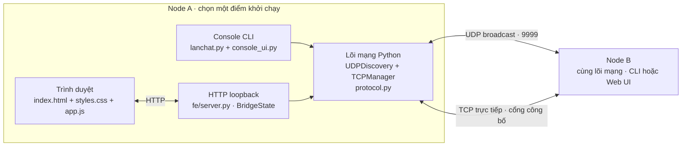
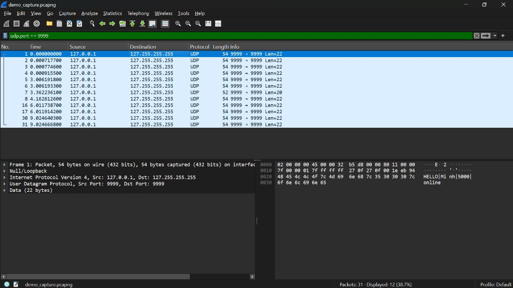
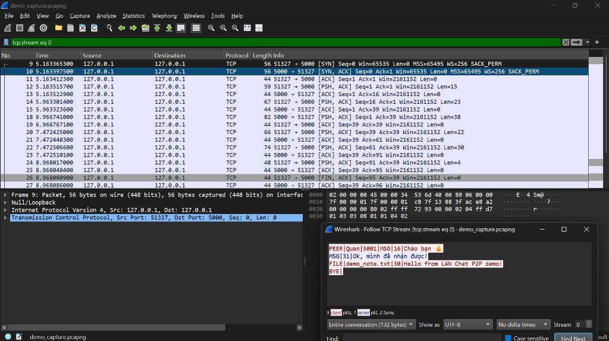

# LAN Chat & File Sharing (P2P)

**Using TCP and UDP Sockets**

BÁO CÁO KỸ THUẬT ĐỒ ÁN · LẬP TRÌNH MẠNG

| Thành viên nhóm Socket_PQH | MSSV |
| --- | --- |
| Châu Hòa Phát | 25127224 |
| Huỳnh Nguyễn Thế Hiển | 25127327 |
| Đỗ Nguyễn Nhật Quang | 25127478 |

**Tóm tắt.** Ứng dụng cho phép các node trong cùng mạng LAN/Wi-Fi tự phát hiện nhau qua UDP broadcast, sau đó mở kết nối TCP trực tiếp để nhắn tin và chia sẻ tệp. Console CLI và Zalo PC Web UI là hai cách vận hành cùng lõi mạng Python. Báo cáo mô tả ranh giới giữa các module, cách bảo toàn khung dữ liệu khi có nhiều luồng, đường đi của tin nhắn và tệp, cùng kết quả kiểm thử có thể đối chiếu.

**Phạm vi đối chiếu** · Repo Socket_PQH, nhánh `main` (cơ sở commit `7b9a90a`, bổ sung capture Wireshark `demo_capture.pcapng`) · 22/11/2026

### Nội dung báo cáo

1. Tổng quan đồ án và phân công nhóm
2. Kiến trúc hệ thống
3. Mô hình đa luồng và đồng bộ hóa
4. Giao thức tầng ứng dụng và TCP framing
5. Console CLI và Zalo PC Web UI
6. Các vấn đề kỹ thuật và giải pháp
7. Kiểm thử và phân tích gói tin với Wireshark

## Chương 1. Tổng quan đồ án và phân công nhóm

### 1.1. Bài toán

Trong cùng mạng LAN/Wi-Fi, người dùng cần thấy những ai đang chạy ứng dụng, chọn một người để chat và gửi tệp. Mỗi node vừa chủ động mở kết nối tới peer, vừa lắng nghe để nhận kết nối. `UDPDiscovery` duy trì danh sách hiện diện, còn `TCPManager` giữ các phiên TCP, lịch sử và hàng đợi tin chưa đọc theo tên peer. Phiên đang được người dùng chọn do `_current_partner` xác định. Dữ liệu chat và tệp đi trực tiếp giữa các node.

### 1.2. Vai trò của UDP và TCP

| Giao thức | Áp dụng trong đồ án | Lý do lựa chọn |
| --- | --- | --- |
| **UDP**, `UDP_PORT = 9999` | `UDPDiscovery` phát và nghe `HELLO`, cập nhật `online` / `away` và thời điểm nhận gần nhất. | Datagram không cần thiết lập kết nối. Một broadcast có thể đến nhiều node cùng miền broadcast. UDP không bảo đảm chuyển phát, nên `_broadcast_loop` phát lặp và `_reap_expired_peers` loại bản ghi hết hạn. |
| **TCP**, `DEFAULT_TCP_PORT = 5000` | Sau khi tìm được IP và cổng nghe của peer, `TCPManager.connect_peer` mở kết nối để gửi tin nhắn và tệp. Mỗi node có thể dùng `--port` để đổi cổng. | TCP cung cấp luồng byte tin cậy, có thứ tự, phù hợp với payload cần đến đủ và đúng thứ tự. `read_frame_header` và độ dài payload giúp khôi phục ranh giới bản tin ở tầng ứng dụng. |

Địa chỉ broadcast mặc định là `DEFAULT_BCAST = "255.255.255.255"`. Cổng UDP có thể đổi bằng `--udp-port` và các node cần dùng cùng cổng discovery để phát hiện nhau. Cùng một máy, các instance dùng cổng TCP nghe khác nhau. Đặc tính tầng giao vận được đối chiếu với [RFC 768](https://www.rfc-editor.org/rfc/rfc768.html) và [RFC 9293, mục 2.2](https://www.rfc-editor.org/rfc/rfc9293.html#section-2.2). Cấu hình ứng dụng nằm ở [protocol.py](lan-chat-p2p/protocol.py) và [lanchat.py](lan-chat-p2p/lanchat.py).

### 1.3. Phân công nhóm theo GUIDE.md

| Họ và tên | MSSV | Phạm vi phụ trách |
| --- | --- | --- |
| Châu Hòa Phát | 25127224 | `protocol.py`, `udp_discovery.py`, `lanchat.py` và thư mục `fe/` (`server.py`, `index.html`, `styles.css`, `app.js`). Thiết kế định dạng gói, phát hiện peer, xử lý lệnh CLI, phụ trách giao diện Zalo PC Web UI và cầu nối HTTP. |
| Huỳnh Nguyễn Thế Hiển | 25127327 | `console_ui.py` và `tcp_manager.py`. Nhập liệu song song với thông báo, điều phối phiên TCP, tin chưa đọc và truyền tệp theo khối. |
| Đỗ Nguyễn Nhật Quang | 25127478 | `REPORT.md`, `REPORT.pdf` và hỗ trợ kiểm thử (`tests/test_p2p.py`). Hỗ trợ hoàn thiện báo cáo kỹ thuật và kiểm thử chức năng CLI, Web UI cùng các tình huống xử lý lỗi. |

Nguồn phân công và ràng buộc triển khai. [GUIDE.md](GUIDE.md) · [AGENTS.md](AGENTS.md) · [README.md](README.md).

## Chương 2. Kiến trúc hệ thống



*Hình 1. Hai giao diện dùng chung thiết kế lõi. Mỗi điểm khởi chạy tạo bộ `UDPDiscovery` và `TCPManager` cho node của mình. HTTP nối trình duyệt với tiến trình trên chính máy đó.*

### 2.1. Trách nhiệm theo tệp

| Tệp trong `lan-chat-p2p/` | Trách nhiệm và thành phần chính |
| --- | --- |
| [`protocol.py`](lan-chat-p2p/protocol.py) | `PeerInfo`, các hằng số mặc định, `encode_hello` / `decode_hello`, `encode_peer`, `encode_msg`, `encode_file_header`, `encode_bye`, `recv_exact` và `read_frame_header`. |
| [`udp_discovery.py`](lan-chat-p2p/udp_discovery.py) | `UDPDiscovery` quản lý socket UDP và bảng peer. `start` / `stop` quản lý vòng đời, `set_status` đổi hiện diện, `get_peers` chụp danh sách và `resolve_peer` tra tên hoặc số thứ tự. |
| [`tcp_manager.py`](lan-chat-p2p/tcp_manager.py) | `TCPManager` mở và nhận kết nối. `connect_peer`, `switch_chat`, `leave_chat` điều phối phiên, `send_chat` và `send_file_async` gửi dữ liệu, `_receiver_loop` xử lý chiều nhận. |
| [`console_ui.py`](lan-chat-p2p/console_ui.py) | `ConsoleUI` đọc dòng, in thông báo, dựng bảng với `show_peers` / `show_help` và cập nhật tiến độ với `update_progress`. |
| [`lanchat.py`](lan-chat-p2p/lanchat.py) | `parse_args` đọc tham số, `main` khởi tạo và nối callback, `handle_command` điều phối lệnh và tin nhắn. |
| [`fe/server.py`](lan-chat-p2p/fe/server.py) | `BridgeState` chuyển callback lõi thành trạng thái UI. `make_handler` tạo `ZaloUIHandler`. `main` chạy HTTP nội bộ, `open_in_chrome_or_default` mở trình duyệt. |
| [`fe/index.html`](lan-chat-p2p/fe/index.html) | Bốn vùng giao diện gồm điều hướng, danh sách peer, chat và khung thông tin. `#emptyChatScreen` và `#activeChatContainer` biểu diễn hai trạng thái chính. |
| [`fe/styles.css`](lan-chat-p2p/fe/styles.css) | Bố cục `.zalo-workspace`, bong bóng tin nhắn, thẻ tệp, tiến độ, hiệu ứng Like và thanh thông tin co giãn. |
| [`fe/app.js`](lan-chat-p2p/fe/app.js) | `pollBackendState` lấy dữ liệu, `renderConversationList` và `renderActiveChat` vẽ giao diện. `selectPeer` và các sự kiện DOM gọi API. |
| [`README.md`](lan-chat-p2p/README.md), [`CONTRACTS.md`](lan-chat-p2p/CONTRACTS.md) | Hướng dẫn cài đặt, chạy (Zalo Web UI và CLI), kiểm thử tự động, demo Wireshark và hợp đồng API của năm module Python lõi. |
| [`tests/test_p2p.py`](lan-chat-p2p/tests/test_p2p.py) | Bộ kiểm thử tự động (`unittest`) cho `protocol.py`, UDP discovery & timeout 10 giây, chat đa peer & `unread`, truyền tệp, 8 lệnh CLI, 4 tình huống lỗi và cầu nối Web UI. |
| [`requirements.txt`](lan-chat-p2p/requirements.txt), [`.gitignore`](lan-chat-p2p/.gitignore), `downloads/.gitkeep` | Ba phụ thuộc CLI. Git bỏ qua môi trường ảo, cache và dữ liệu trong `downloads/`, ngoại trừ `.gitkeep` để giữ thư mục. |

## Chương 3. Mô hình đa luồng và đồng bộ hóa

### 3.1. Luồng thực thi

| Luồng | Hàm và hành vi | Thời gian chờ / phạm vi |
| --- | --- | --- |
| Main | `lanchat.py:main` gọi `ConsoleUI.read_line` rồi `handle_command`. `fe/server.py:main` chạy `ThreadingHTTPServer.serve_forever`. | Web có luồng xử lý theo kết nối HTTP. Khi tự mở trình duyệt, `threading.Timer` gọi `open_in_chrome_or_default` sau 0,4 giây. |
| `udp-broadcaster` | `UDPDiscovery._broadcast_loop` gọi `_send_presence_once`. | Phát ngay, rồi đợi `BROADCAST_INTERVAL = 3.0` giây bằng `Event.wait`. |
| `udp-listener` | `UDPDiscovery._listen_loop` đọc `recvfrom(1024)`, gọi `_handle_datagram` và chạy `_reap_expired_peers` sau mỗi vòng. | Socket `settimeout(1.0)`. Peer hết hạn khi tuổi bản ghi lớn hơn `PEER_TIMEOUT = 10.0` giây. |
| `tcp-acceptor` | `TCPManager._accept_loop` gọi `accept`, tạo receiver cho socket vừa nhận. | Timeout trên socket nghe là 1,0 giây. Socket phiên chuyển sang chờ blocking bằng `settimeout(None)`. |
| `tcp-recv-<peer>` hoặc `tcp-recv-<ip>:<port>` | `TCPManager._receiver_loop` xử lý `PEER`, `MSG`, `FILE` và `BYE`. | Một daemon thread theo socket. Tên luồng đến dùng IP và cổng nguồn, kể cả sau khi đã đọc định danh. |
| `file-send-<partner>` | `send_file_async` tạo daemon thread chạy `_send_file_worker` với partner, socket và khóa gửi đã chọn. | Một luồng cho mỗi yêu cầu gửi tệp hợp lệ. Đọc tệp với `CHUNK_SIZE = 8192` byte. |

### 3.2. Phạm vi của các khóa

| Khóa | Dữ liệu và phạm vi |
| --- | --- |
| `UDPDiscovery._lock` | Bảo vệ `_peers` và `_status`. `get_peers` tạo các `PeerInfo` mới từ bảng hiện tại. |
| `TCPManager._lock` | Bảo vệ các đoạn đọc/ghi `_connections`, `_chat_histories`, `_unread_messages`, `_current_partner` và `_file_threads` ở lõi. |
| `TCPManager._send_locks[peer_name]` | Tuần tự hóa `sendall` đối với tin nhắn và toàn bộ khung tệp. Giữ khóa qua header và mọi khối tệp để byte của `MSG` không bị chèn giữa payload `FILE`. |
| `ConsoleUI._lock` và `BridgeState._lock` | Console tuần tự hóa việc xuất và sửa `_progress_bars`. Bridge khóa cập nhật `histories`, `unreads`, `known_tcp_peers`, bộ đếm ID và `transfer`. |

`_handle_incoming_message` nhả khóa lõi trước `on_chat` hoặc `on_unread`. `_receiver_loop` đọc header, đọc payload và gọi `_receive_file` ngoài khóa trạng thái chung. Các nhánh báo `on_system` và `on_error` cũng thực hiện bên ngoài khóa lõi. Cách này giảm nguy cơ deadlock khi I/O hoặc callback đi vào UI. Riêng `_send_file_worker` gọi `on_progress` trong lúc vẫn giữ **khóa gửi theo peer**. Khởi chạy worker trả quyền điều khiển cho UI, nhưng một lần `send_chat` sau đó tới cùng peer có thể chờ hết lượt gửi tệp.

**Giới hạn đồng bộ Web.** `BridgeState._on_unread` và `snapshot` đọc trực tiếp một số cấu trúc riêng của `TCPManager` mà không dùng khóa của lõi cho các lần đọc đó. `snapshot` còn trả tham chiếu `histories` và `unreads` cho bước tạo JSON phía sau. Vì vậy snapshot Web là cơ chế đồng bộ hiển thị định kỳ, với mức nhất quán phụ thuộc thời điểm các luồng cập nhật. [udp_discovery.py](lan-chat-p2p/udp_discovery.py) · [tcp_manager.py](lan-chat-p2p/tcp_manager.py) · [console_ui.py](lan-chat-p2p/console_ui.py) · [fe/server.py](lan-chat-p2p/fe/server.py).

## Chương 4. Giao thức tầng ứng dụng và TCP framing

### 4.1. UDP Presence

```text
HELLO|<name>|<tcp_port>|<status>
```

`encode_hello` cắt khoảng trắng đầu/cuối tên, đổi `|` trong tên thành `_`, chuẩn hóa trạng thái về chữ thường và mã hóa UTF-8. `decode_hello` kiểm tra đúng bốn trường và tag `HELLO`, tên khác rỗng, cổng TCP số nguyên trong `1..65535` và trạng thái thuộc `VALID_STATUSES = ("online", "away")`. Datagram sai cấu trúc trả `None`. `UDPDiscovery._handle_datagram` lấy địa chỉ IP từ nguồn `recvfrom`, lưu tên, IP, cổng TCP, trạng thái và `last_seen` vào `PeerInfo`. Gói có tên trùng tên node được bỏ qua. [protocol.py](lan-chat-p2p/protocol.py) · [udp_discovery.py](lan-chat-p2p/udp_discovery.py).

### 4.2. Bốn dạng khung TCP

```text
PEER|<name>|<tcp_port>|
MSG|<byte_length>|<utf-8 bytes>
FILE|<safe_filename>|<size_in_bytes>|<raw file bytes>
BYE|
```

| Hàm tạo khung | Hành vi |
| --- | --- |
| `encode_peer` | `connect_peer` gửi sau `connect`. `_receiver_loop` phân tích header qua `read_frame_header` và đăng ký socket theo tên nhận được. Nếu client như netcat gửi thẳng một khung hợp lệ, tên dự phòng là `f"{addr[0]}:{addr[1]}"`. `tcp_port` có trong khung và được kiểm tra, còn receiver hiện chỉ dùng `remote_name` để đăng ký. |
| `encode_msg` | Tạo header bằng `len(payload)` sau `text.encode("utf-8")`. Ví dụ `Chào bạn 👍` có 10 ký tự Python và 16 byte UTF-8, nên header là `MSG\|16\|`. Đếm theo ký tự khiến byte còn lại bị hiểu nhầm là phần đầu của khung kế tiếp. |
| `encode_file_header` | `os.path.basename` lấy tên cuối của đường dẫn và encoder thay `\|` trong tên bằng `_`. Worker gửi header, tiếp theo là vùng dữ liệu nhị phân có độ dài ghi trong header khi truyền hoàn tất. |
| `encode_bye` | Tạo `BYE\|` khi chủ động rời phiên hoặc tắt ứng dụng. Receiver gặp `BYE` thì thoát vòng đọc và dọn kết nối. |

### 4.3. Thuật toán đọc và các tình huống biên

TCP có thể đưa một phần khung hoặc nhiều khung liền nhau trong cùng luồng byte. `read_frame_header` dùng `_read_field(sock, allow_eof_on_first=True)` cho trường loại. Hàm đọc `sock.recv(1)` tới dấu `|`, bỏ `\r` / `\n` trước byte đầu trường loại và từ chối trường dài hơn `_MAX_FIELD_BYTES = 1024`. EOF ở ranh giới khung trả `None`. EOF ở giữa header phát sinh `ConnectionError`.

Với `MSG`, `recv_exact` lặp `sock.recv(min(CHUNK_SIZE, n - len(buf)))` tới đủ `n` byte, kể cả khi một lần đọc trả ít hơn yêu cầu. `b""` trước khi đủ byte gây `ConnectionError`. Với `FILE`, `_receive_file` đọc tối đa số byte còn thiếu trong từng vòng và ghi thẳng xuống đĩa, rồi tiếp tục đọc header ngay sau byte cuối của tệp. Giới hạn 1024 byte áp dụng cho từng trường header. Mã hiện không đặt hạn mức tổng cho payload do peer khai báo. [protocol.py](lan-chat-p2p/protocol.py) · [tcp_manager.py](lan-chat-p2p/tcp_manager.py) · [RFC 9293, mục 2.2](https://www.rfc-editor.org/rfc/rfc9293.html#section-2.2).

## Chương 5. Console CLI và Zalo PC Web UI

### 5.1. Console CLI

`lanchat.py:main` nối các callback của `TCPManager` vào `ConsoleUI`. `ConsoleUI.__init__` chỉ tạo `PromptSession` khi cả `sys.stdin` và `sys.stdout` là TTY. `patch_stdout(raw=True)` được đặt trong `ExitStack` để chương trình có thể in thông báo nền và vẽ lại prompt mà vẫn giữ chữ đang gõ. Khi chạy qua pipe, hoặc nếu khởi tạo phiên prompt thất bại, `read_line` ghi prompt rồi đọc bằng `sys.stdin.readline()`. EOF được `main` dùng làm tín hiệu thoát và dọn tài nguyên.

`show_peers` và `show_help` dựng `rich.table.Table` cho `/list` và `/help`. `update_progress` cập nhật thanh `tqdm` theo số byte. Khi in thông báo cùng lúc có thanh đang hoạt động, `_print_with_bars_paused` gọi `bar.clear()`, `self._console.print()` rồi `bar.refresh()` dưới khóa UI. Ba phụ thuộc khai báo là `prompt_toolkit>=3.0.43`, `rich>=13.7.0` và `tqdm>=4.66.0`. [console_ui.py](lan-chat-p2p/console_ui.py) · [lanchat.py](lan-chat-p2p/lanchat.py) · [requirements.txt](lan-chat-p2p/requirements.txt).

| Lệnh CLI | Xử lý trong `handle_command` và module lõi |
| --- | --- |
| `/list` | Gọi `UDPDiscovery.get_peers()` và hiển thị bảng `#`, `Name`, `IP Address`, `TCP Port`, `Status` qua `ConsoleUI.show_peers`. |
| `/chat <name\|number>` | Tra peer theo STT 1-based hoặc tên (`resolve_peer`), mở kết nối TCP hoặc chuyển phiên hiện tại và in các tin `unread` nếu có. |
| `<any text>` | Mọi dòng không bắt đầu bằng `/` được gửi tới `_current_partner` qua `TCPManager.send_chat`. |
| `/send <file>` | Kiểm tra tệp tồn tại rồi tạo luồng nền gửi tệp theo khối `8192` byte (`send_file_async`), giữ nguyên luồng nhập CLI. |
| `/leave` | Gửi khung `BYE\|`, đóng socket phiên hiện tại (`leave_chat`) và đưa đối tác hoạt động về rỗng. |
| `/status <online\|away>` | Xác thực trạng thái thuộc `VALID_STATUSES`, cập nhật `UDPDiscovery.set_status` và phát gói `HELLO` ngay lập tức. |
| `/help` | Hiển thị bảng hướng dẫn toàn bộ 8 lệnh CLI qua `ConsoleUI.show_help`. |
| `/quit` | Thoát vòng lặp nhập, gọi `discovery.stop()`, gửi `BYE\|` cho các phiên đang mở trong `tcp.stop()` và đóng `ConsoleUI`. |

### 5.2. Cầu nối HTTP và các endpoint

`fe/server.py:main` bind `ThreadingHTTPServer` tại `127.0.0.1`, cổng mặc định 8080 (`--web-port`). `make_handler` tạo `ZaloUIHandler` từ `SimpleHTTPRequestHandler` của thư viện chuẩn Python. Handler phục vụ các tài nguyên tĩnh từ `FE_DIR` và gọi `BridgeState` cho lớp API. Luồng HTTP phục vụ trình duyệt trên máy cục bộ, còn `state.discovery` và `state.tcp` trực tiếp giao tiếp với peer qua UDP/TCP.

| Phương thức và đường dẫn | Hành vi trong `ZaloUIHandler` |
| --- | --- |
| `GET /api/state` | Trả JSON từ `BridgeState.snapshot`. `peers` hợp nhất discovery UDP, `known_tcp_peers` và tên trong `_connections`, ưu tiên thông tin UDP. Snapshot có `selfName`, `selfStatus`, `tcpPort`, `udpPort`, `activePartner`, `histories`, `unreads` và `transfer`. |
| `GET /downloads/<filename>` | Giải mã URL, lấy basename trong `downloads/`, đoán MIME bằng `mimetypes.guess_type` và trả `Content-Disposition: inline`. Handler đọc toàn bộ tệp vào bộ nhớ trước khi gửi. |
| `POST /api/chat` | Tra `target`, gọi `switch_chat` và xóa bộ đếm Web của người được chọn. Giá trị `ok` ở đây không xác nhận kết nối TCP đã mở. |
| `POST /api/leave` | Gọi `TCPManager.leave_chat` cho phiên hiện tại. |
| `POST /api/send` | Chọn `target` nếu khác đối tác hiện tại, rồi gọi `TCPManager.send_chat` nếu có `text`. |
| `POST /api/status` | Nếu trạng thái hợp lệ, gọi `UDPDiscovery.set_status` để phát ngay và cập nhật `BridgeState.status`. |
| `POST /api/react` | Truyền `target` và `msgId` vào `BridgeState.toggle_reaction` để tăng bộ đếm Like cục bộ. |
| `POST /api/send_file` | Đọc `multipart/form-data` với `target` và `file`, lưu bản sao `downloads/<safe_name>` rồi gọi `state.tcp.send_file_async(saved_path)`. `ok` báo đã khởi chạy worker. |
| `POST /api/open_file` | Kiểm tra tên và sự tồn tại trong `downloads/`, gọi `os.startfile(full_path)` khi hệ điều hành hỗ trợ. Trả `openedOnOS` và URL để trình duyệt mở khi cần. |
| `POST /api/reveal_file` | Với tệp tồn tại trên Windows, gọi `explorer.exe` kèm `/select,` và đường dẫn để chọn tệp. |

Nguồn định tuyến và dữ liệu. [fe/server.py](lan-chat-p2p/fe/server.py) · [fe/app.js](lan-chat-p2p/fe/app.js).

### 5.3. Trải nghiệm Zalo PC Web UI

**Khởi chạy.** Từ thư mục `lan-chat-p2p/`, có thể dùng một trong hai điểm vào sau. `open_in_chrome_or_default` ưu tiên Google Chrome nếu tìm thấy trên Windows, rồi thử trình duyệt mặc định qua `webbrowser.open`. Tham số `--no-browser` tắt thao tác tự mở.

```powershell
python lanchat.py --name NodeA --port 5000
python fe/server.py --name NodeB --port 5001 --web-port 8080
```

| Thành phần | Hành vi và dấu vết trong mã nguồn |
| --- | --- |
| Danh sách người dùng và màn hình chờ | `lanPeers` khởi tạo rỗng. `pollBackendState` lấy `/api/state` mỗi 800 ms. `renderConversationList` dựng danh sách từ peer thực tế mà backend biết qua UDP, phiên TCP hoặc các peer TCP từng gửi tin/tệp. `renderActiveChat` hiển thị `#emptyChatScreen` khi chưa chọn được peer. `known_tcp_peers` không được dọn theo timeout UDP, nên người đã tương tác vẫn có thể xuất hiện sau khi mất kết nối. |
| Bảng Thông tin [LAN] | `#infoResizeHandle` bắt `mousedown`, cửa sổ xử lý `mousemove` và `mouseup`. Bề rộng cập nhật trong 220–520 px. Kéo xuống dưới ngưỡng 130 px sẽ đóng bảng. `#collapseInfoBtn` đóng, `#infoPullTab` mở lại, `#toggleRightPanelBtn` chuyển đổi hai trạng thái. |
| Like trên bong bóng | Bản ghi có `likes: 0` khi tạo. `.reaction-hover-btn` mặc định `opacity: 0`, selector `.msg-bubble:hover .reaction-hover-btn` làm nút hiện khi rê chuột. Sau cú bấm, `/api/react` tăng bộ đếm và giao diện hiển thị `👍 N`. Bấm tiếp tăng thêm. Giá trị này nằm trong `BridgeState.histories` của node đang chạy giao diện. |
| Tệp và ảnh xem trước | `renderActiveChat` dựng thẻ từ `m.file`. `isImageFilename` chọn ảnh xem trước theo phần mở rộng. Nút **Mở ngay** gọi `openFileImmediately`, thử mở qua hệ điều hành trước khi dùng `window.open`. Nút **Mở thư mục** gọi `revealFileInDownloads` để chọn tệp trong Explorer trên Windows. |

**Đường đi của một tệp qua Web.** `hiddenFileInput` đưa `FormData` từ trình duyệt qua loopback. Handler lưu upload vào `downloads/` và khởi chạy worker TCP. Node nhận ghi các khối vào `downloads/` của mình. Khi `_receive_file` báo hoàn tất, `BridgeState._on_system` trích tên, kích thước và nguồn gửi từ thông báo để tạo thẻ tệp. Trình duyệt nhận thẻ qua lần poll tiếp theo và lấy ảnh từ `GET /downloads/<filename>`.

**Ý nghĩa của tiến độ.** `BridgeState._on_progress` cập nhật một trạng thái `transfer` theo số byte xử lý gần nhất. `app.js` còn đặt 35% khi bắt đầu upload và 100% khi yêu cầu HTTP trả về. Hai mốc hiển thị này thuộc vòng đời yêu cầu Web. Kết quả nhận đủ byte được xác định ở `_receive_file` của node đích. [fe/index.html](lan-chat-p2p/fe/index.html) · [fe/styles.css](lan-chat-p2p/fe/styles.css) · [fe/app.js](lan-chat-p2p/fe/app.js) · [fe/server.py](lan-chat-p2p/fe/server.py) · [tcp_manager.py](lan-chat-p2p/tcp_manager.py).

## Chương 6. Các vấn đề kỹ thuật và giải pháp

### 6.1. Chia sẻ cổng UDP trên một máy

`UDPDiscovery._make_socket` bật `SO_REUSEADDR` và `SO_BROADCAST` trước `bind(("", self.udp_port))`. `SO_REUSEPORT` chỉ được thử khi hệ điều hành có hằng số, lỗi `OSError` được bỏ qua. Thiết lập này hỗ trợ nhiều instance dùng chung cổng discovery. Việc phân phối datagram còn phụ thuộc socket stack và cấu hình Windows/macOS/Linux. Khi `sendto` tới địa chỉ đã cấu hình thất bại, `_send_presence_once` thử `127.255.255.255`, trừ khi đây đã là địa chỉ truyền vào. Khi thử offline có thể chọn loopback broadcast qua `--bcast 127.255.255.255`. [udp_discovery.py](lan-chat-p2p/udp_discovery.py#L47).

### 6.2. Giảm thời gian khám phá node vừa khởi động

Nếu chỉ chờ bản tin định kỳ, node mới có thể phải chờ gần một chu kỳ `BROADCAST_INTERVAL = 3.0` giây để thấy node cũ. `_handle_datagram` đặt `is_new_peer = True` khi thêm tên mới, nhả `_lock` rồi gọi ngay `_send_presence_once`. Discovery hai chiều có thể hoàn tất ngay sau lượt phản hồi nếu datagram đến được. Độ trễ tính theo mili-giây chưa được đo trong báo cáo. [udp_discovery.py](lan-chat-p2p/udp_discovery.py#L176).

### 6.3. Nhận diện tên từ kết nối TCP đến

`accept` chỉ cung cấp IP và cổng nguồn, thường là cổng tạm thời do hệ điều hành chọn. `connect_peer` dùng `encode_peer` để gửi tên hiển thị và cổng nghe trong khung định danh. `_receiver_loop` ánh xạ socket theo tên từ khung, nhờ đó phân biệt được nhiều node dùng chung IP nếu tên khác nhau. Tên do peer tự khai báo và ứng dụng hiện không có bước xác thực riêng. [tcp_manager.py](lan-chat-p2p/tcp_manager.py#L131) · [protocol.py](lan-chat-p2p/protocol.py#L67).

### 6.4. Tin đến từ peer ngoài phiên đang chọn

`_handle_incoming_message` luôn ghi vào `_chat_histories[sender]`. Nếu `sender` khác `_current_partner`, tin được đưa vào `_unread_messages[sender]` và `on_unread` nhận số lượng hiện tại. `switch_chat` lấy và xóa hàng đợi của peer được chọn dưới khóa. CLI in danh sách tin trả về từ `switch_chat`. Web tích lũy lịch sử từ callback và xóa bộ đếm hiển thị khi mở peer. [tcp_manager.py](lan-chat-p2p/tcp_manager.py#L423) · [lanchat.py](lan-chat-p2p/lanchat.py#L52) · [fe/server.py](lan-chat-p2p/fe/server.py#L123).

### 6.5. Đóng socket và xử lý tệp nhận dở

Khi thoát, `TCPManager.stop` chụp danh sách worker còn chạy trong `_file_threads` rồi gọi `t.join(timeout=2.0)` cho từng luồng. `stop` và `leave_chat` đều cố gửi `encode_bye()`, gọi `sock.shutdown(socket.SHUT_WR)` rồi `sock.close()`. Trình tự này hỗ trợ đóng chiều gửi có trật tự, kể cả khi chạy qua Winsock. Ở phía nhận, EOF sớm gây `ConnectionError`. `_receive_file` thử `os.remove(dest_path)` trong nhánh lỗi và truyền lỗi lên vòng nhận để dọn kết nối. Lỗi xóa tệp được bỏ qua. Chương trình hiện không có xác nhận ghi tệp từ peer nhận. [tcp_manager.py (stop/leave)](lan-chat-p2p/tcp_manager.py#L86) · [tcp_manager.py (_receive_file)](lan-chat-p2p/tcp_manager.py#L443).

### 6.6. Giảm nguy cơ Path Traversal khi xử lý tên tệp

`encode_file_header` và `read_frame_header` lấy `os.path.basename()`. `_receive_file` lấy basename lần nữa trước khi ghép với `downloads_dir`. Web thực hiện cùng bước ở lượt upload, phục vụ nội dung, mở tệp và hiện vị trí tệp. Biện pháp này bỏ thành phần thư mục theo quy tắc đường dẫn của hệ điều hành. Mã hiện mở đích bằng `"wb"`, nên hai tệp cùng tên có thể ghi đè. Kiểm soát liên kết tệp và chính sách xử lý tên trùng nằm ngoài cơ chế basename hiện tại. [protocol.py](lan-chat-p2p/protocol.py#L84) · [tcp_manager.py](lan-chat-p2p/tcp_manager.py#L443) · [fe/server.py](lan-chat-p2p/fe/server.py#L255).

### 6.7. Xử lý lỗi phiên ngắt, peer ngoại tuyến, thiếu tệp và lệnh sai

- **Peer đóng kết nối hoặc crash:** `_receiver_loop` bắt `EOF`, `BYE|`, `ConnectionError`, `OSError` hoặc `ValueError` và gọi `_cleanup_connection`. Nếu socket thuộc `_current_partner`, trạng thái đối tác được đặt về `None` và callback báo thông báo quay về dấu nhắc chính; nếu `send_chat` gặp `OSError`, lõi cũng báo lỗi qua `on_error` và dọn kết nối tương tự.
- **Kết nối tới peer đã ngoại tuyến:** Nếu peer không có trong bảng UDP (hoặc `tcp_port <= 0`) hay từ chối kết nối TCP (`ConnectionRefusedError` / timeout 5 giây), `connect_peer` đóng socket, báo qua `on_error` và trả `False` mà không làm dừng chương trình.
- **Thiếu tệp hoặc gián đoạn truyền:** `send_file_async` chuẩn hóa dấu ngoặc kép bao quanh đường dẫn, kiểm tra `os.path.isfile(clean_path)` trước khi khởi chạy worker và báo lỗi ngay nếu không tìm thấy tệp; trường hợp đứt kết nối giữa chừng được `_receive_file` xóa bỏ tệp nhận dở như mô tả ở mục 6.5.
- **Lệnh không hợp lệ:** `handle_command` giữ vòng lặp CLI hoạt động liên tục và gọi `ui.print_error` gợi ý người dùng xem `/help` khi gặp lệnh lạ hoặc thiếu tham số cho `/chat`, `/send`, `/status`. [lanchat.py](lan-chat-p2p/lanchat.py#L52) · [tcp_manager.py](lan-chat-p2p/tcp_manager.py#L131).

## Chương 7. Kiểm thử và phân tích gói tin với Wireshark

### 7.1. Kết quả kiểm tra trên máy Windows

Kiểm tra thực hiện bằng Python `3.12.2` (`py -3.12`) trên mã nguồn repo `Socket_PQH` kèm bộ kiểm thử tự động [`tests/test_p2p.py`](lan-chat-p2p/tests/test_p2p.py). Các kịch bản tích hợp dùng socket thật trên loopback (`127.255.255.255` cho UDP broadcast, `127.0.0.1` cho TCP và HTTP) với cổng cấp phát động và thư mục `downloads/` tạm độc lập.

| Kịch bản | Kết quả quan sát |
| --- | --- |
| Biên dịch cú pháp và lint | Cả 7 tệp Python biên dịch (`py_compile`) và kiểm tra `ruff check` đạt sạch không cảnh báo. |
| Unit test `protocol.py` (7 ca) | **7/7 đạt.** Round-trip và kiểm tra gói `HELLO` lỗi, `PEER` / `BYE` và EOF sạch, khung UTF-8 (`Chào bạn 👍` = 16 byte) nối liền nhau, header `FILE` + basename, giới hạn 1024 byte, EOF sớm và `recv_exact` phân mảnh. |
| UDP discovery 2 instance | Hai node thấy nhau, phân giải theo STT `1` hoặc tên không phân biệt hoa thường, nhận thay đổi `away` và tự loại node dừng sau `PEER_TIMEOUT = 10.0s` kèm thông báo `went offline`. |
| Chat TCP, peer thứ 3 và `unread` | Trong lúc `NodeB` chat với `NodeA`, `NodeC` gửi 2 tin tạo `(unread, 1)` và `(unread, 2)`. Chuyển `/chat` sang `NodeC` trả đủ 2 tin, xóa bộ đếm; `/leave` đóng phiên và đưa đối tác về rỗng. |
| Truyền tệp song song với chat | `NodeA` gửi tệp nhị phân 256 KB qua `send_file_async` đồng thời nhận tin nhắn từ `NodeB`; tiến độ đạt 100% và tệp nhận khớp SHA-256 từng byte. |
| 4 tình huống xử lý lỗi (mục 5.3) | Báo lỗi không crash khi kết nối peer offline hoặc thiếu tệp; truyền tệp đứt giữa chừng tự xóa ngay tệp nhận dở `broken.bin`; `../escape.txt` bị cắt còn `escape.txt` trong `downloads/`. |
| CLI 8 lệnh, giữ dòng đang gõ và 2 tiến trình | Đủ 8 lệnh + lệnh lạ (`/unknown`) chạy đúng; `PromptSession` + `patch_stdout` giữ nguyên chuỗi `"you can che"` khi luồng nền in `[Minh] ok, which part?`; bảng `rich` và `tqdm` hoạt động; 2 tiến trình `lanchat.py` giao tiếp qua pipe và thoát mã `0`. |
| Tích hợp 2 node Web UI (`fe/server.py`) | Hai `ThreadingHTTPServer` trao đổi UDP `away`, chat `Chào bạn 👍`, tăng Like cục bộ trên `NodeB` (giữ `0` trên `NodeA`), gửi/nhận `demo.bmp` (70 byte) qua `/api/send_file` và `GET /downloads/demo.bmp` (`image`, `Content-Disposition: inline`). |

Tổng kết chạy `py -3.12 -m unittest discover -s tests -v`: **16/16 ca kiểm thử đạt** (thời gian chạy khoảng 19,5 giây, trong đó có phép thử chờ hết hạn UDP 10 giây thực).

### 7.2. Phạm vi demo theo tài liệu nhóm

`GUIDE.md` có checklist đã đánh dấu cho nhiều terminal CLI, giữ dòng đang gõ, tin đến từ peer thứ ba, tiến độ truyền tệp và dọn tệp nhận dở; các kịch bản lõi tương ứng hiện đã có thể tái lập tự động qua [`tests/test_p2p.py`](lan-chat-p2p/tests/test_p2p.py). Lưu ý môi trường chạy kiểm thử tự động `PromptSession` sử dụng `create_pipe_input` và `DummyOutput` thay cho console TTY vật lý, còn thao tác trực tiếp bằng chuột/bàn phím trên trình duyệt Chrome cần chạy thực tế khi demo.

Ca **kiểm thử trên 2 máy LAN/Wi-Fi rời** hiện chưa có ảnh chụp trực tiếp trong tài liệu này. Hai ảnh chụp **Wireshark** thu từ phiên chạy thực tế hai instance trên cùng máy Windows (`Minh` cổng `5000` và `Quan` cổng `5001` qua giao diện loopback `127.0.0.1` / `127.255.255.255`) đã được đính kèm và phân tích ở mục 7.3. Để demo trực tiếp trên 2 máy LAN/Wi-Fi, chạy một node trên mỗi máy cùng LAN với tên khác nhau, dùng cùng cổng UDP và cổng TCP mặc định nếu còn trống; kiểm tra thấy nhau qua `/list`, gửi và đáp một tin UTF-8, truyền một ảnh và so sánh tệp nhận trong `downloads/`. [GUIDE.md](GUIDE.md) · [Hướng dẫn chạy và demo](lan-chat-p2p/README.md).

### 7.3. Phân tích capture UDP và TCP trên Wireshark

Ảnh thu từ phiên chạy thực tế giữa `Minh` (`--port 5000`) và `Quan` (`--port 5001`) với `--bcast 127.255.255.255`, bắt bằng `Wireshark 4.6.10` / `Npcap` trên `Adapter for loopback traffic capture` (`demo_capture.pcapng`, tổng cộng `31` gói). Khi chạy trên 2 máy LAN/Wi-Fi rời, địa chỉ đích UDP broadcast sẽ là `255.255.255.255` thay cho `127.255.255.255`.



*Hình 7.1. Gói UDP broadcast `HELLO` trên cổng `9999` với bộ lọc `udp.port == 9999` (`12/31` gói được hiển thị).*

- **Phát hiện peer và trạng thái qua UDP (`udp.port == 9999`):** Các gói từ `127.0.0.1:9999` gửi tới `127.255.255.255:9999` lặp lại theo chu kỳ `3` giây (`0.000s`, `3.006s`, `6.011s`, `9.024s`). Xen giữa có các gói phản hồi tức thì khi peer mới xuất hiện (`t ≈ 0.0007s–0.0009s`) và gói đổi trạng thái (`/status away` ở Frame `7`, `t = 3.362236s`, `Len=20`, sau đó quay lại `online` ở Frame `8`, `t = 4.162612s`, `Len=22`). Khung **Packet Bytes** ở Frame `1` hiển thị nguyên vẹn payload `HELLO|Minh|5000|online`.



*Hình 7.2. Phiên TCP `tcp.stream eq 0` trên cổng nghe `5000`: bắt tay ba bước (`Frames 9–11`), khung dữ liệu ghép qua **Follow TCP Stream (`UTF-8`, `132 bytes`)** và đóng kết nối (`Frames 26–27`).*

1. **Thiết lập kết nối (`Frames 9–11`, `t ≈ 5.163s`):** Khi `Quan` mở `/chat Minh`, Wireshark ghi nhận đủ 3 gói bắt tay: `[SYN]` từ cổng tạm `51327 → 5000`, `[SYN, ACK]` chiều ngược lại `5000 → 51327` và `[ACK]` hoàn tất kết nối.
2. **Dữ liệu ứng dụng (`Frames 12–24`) & Follow TCP Stream (`UTF-8`, `132 bytes`):** Chiều gửi từ `Quan` (màu đỏ) chứa lần lượt khung định danh `PEER|Quan|5001|`, tin nhắn `MSG|16|Chào bạn 👍`, khung tệp `FILE|demo_note.txt|30|Hello from LAN Chat P2P demo!` và lệnh thoát phiên `BYE|`; chiều phản hồi từ `Minh` (màu xanh) mang tin nhắn `MSG|31|Ok, mình đã nhận được!`.
3. **Đóng kết nối (`Frames 26–29`, `t ≈ 8.968s`):** Sau khi gửi `BYE|` ở Frame `24`, lệnh `/leave` đóng chiều gửi bằng Frame `26` (`[FIN, ACK]`) và nhận xác nhận `Frame 27` (`[ACK]`), hoàn tất ngắt phiên sạch không gây `RST`.

Tham chiếu thao tác và nguyên lý đọc capture. [Wireshark User’s Guide, mục 7.2](https://www.wireshark.org/docs/wsug_html_chunked/ChAdvFollowStreamSection.html) · [RFC 9293, mục 3.5](https://www.rfc-editor.org/rfc/rfc9293.html#section-3.5) · [RFC 9293, mục 3.6](https://www.rfc-editor.org/rfc/rfc9293.html#section-3.6).

### Kết luận

Kết quả kiểm thử loopback xác nhận hai node dùng UDP để tìm và cập nhật hiện diện (bao gồm timeout 10 giây), sau đó dùng cùng phiên TCP cho tin nhắn UTF-8, hàng đợi `unread`, xử lý 4 tình huống lỗi và truyền tệp song song đúng từng byte qua cả Console CLI lẫn Zalo PC Web UI. `read_frame_header`, trường chiều dài và khóa gửi theo peer bảo toàn ranh giới khung trên luồng TCP. Hai ảnh chụp Wireshark đã xác minh trực quan gói broadcast UDP `HELLO`, bắt tay ba bước TCP, toàn bộ framing `PEER`/`MSG`/`FILE`/`BYE` và đóng phiên bằng `FIN`; demo trực tiếp trên 2 máy LAN/Wi-Fi rời sẽ bổ sung kiểm chứng thực địa trong buổi báo cáo.
